# CloudFormation Lab

**Maxamed Maxamed, L00213552**
MSc Computing in DevOps, Atlantic Technological University

[](https://github.com/Maxamed-Maxamed/l00213552-cloudformation-lab-aws-atu/actions/workflows/cfn-lint.yml)

## Contents

1. [Introduction](#1-introduction)
2. [Repository structure](#2-repository-structure)
3. [How the work was organised](#3-how-the-work-was-organised)
4. [Part A.a: Static website](#4-part-aa-static-website)
5. [Part A.b: Three tier architecture](#5-part-ab-three-tier-architecture)
6. [Continuous integration](#6-continuous-integration)
7. [Part B: Best practices, power tools and ilities](#7-part-b-best-practices-power-tools-and-ilities)
8. [Choice of tool and critique](#8-choice-of-tool-and-critique)
9. [Limitations and future work](#9-limitations-and-future-work)
10. [How to deploy and delete](#10-how-to-deploy-and-delete)
11. [Use of LLMs and tutorials](#11-use-of-llms-and-tutorials)
12. [References](#12-references)

## 1. Introduction

This repository is my submission for the CloudFormation Lab. The brief has two practical parts. Part A.a asks for a CloudFormation script that creates a website with my L number and name as the header, with the static pages stored in Amazon S3 and served through a public facing web service. Part A.b asks for a second, separate setup: a three tier architecture with a web tier, an application tier and a database tier. Part B asks for best practice throughout, sensible use of power tools, and attention to security, scalability and performance.

AWS describes CloudFormation as its foundational infrastructure as code (IaC) service. A YAML or JSON template describes the resources, and CloudFormation creates, updates and deletes them together as one unit called a stack [1], [2]. Treating infrastructure as code means the review, testing and version control habits used for application code can also be applied to networks, servers and databases [3]. That idea shaped the way I worked. Every change was made in a template, committed on its own branch, reviewed in a pull request, checked by an automated linter, and only then applied to AWS through a change set.

Both setups were built in small steps. Each step started simple, was deployed and tested, and was then improved in the next pull request. This README explains the design of each step, the evidence that it works, the trade offs I made and what I would change next. Screenshots are numbered as figures. Sources are numbered in square brackets and listed in Section 12.

| Setup | Template | Stack name | Main AWS services |
|---|---|---|---|
| Static website (Part A.a) | `static-site/template.yaml` | `maxamed-l00213552-static-site-basic` | S3, CloudFront, Lambda, IAM, CloudWatch Logs |
| Three tier architecture (Part A.b) | `three-tier/template.yaml` | `maxamed-l00213552-three-tier` | VPC, Elastic Load Balancing, EC2 Auto Scaling, RDS for MySQL, Secrets Manager |
| Pipeline | `.github/workflows/cfn-lint.yml` | Not applicable | GitHub Actions, cfn-lint |

Both stacks were deployed to the US East (N. Virginia) Region, `us-east-1`.

## 2. Repository structure

```
.
├── .github/workflows/cfn-lint.yml   GitHub Actions workflow that lints both templates
├── static-site/template.yaml        Part A.a: static website
├── three-tier/template.yaml         Part A.b: three tier architecture
├── docs/
│   ├── llm-prompts.md               declaration of LLM prompts and tutorials (Part A.2)
│   └── images/                      screenshots used as figures in this README
├── .gitignore
└── README.md                        this write up
```

## 3. How the work was organised

**Branches and pull requests.** Every change was made on a short lived branch named after its purpose (`feature/`, `docs/` or `ci/`) and merged into `main` through a pull request. Each pull request description followed the same layout: what changed, why, how I tested it, and known limitations. The last heading was deliberate. Writing down what a version could not yet do gave the reason for the next pull request. Pull requests were merged with merge commits rather than squashed, so the individual commits inside each one stay visible in the history. All commits were made by me, from my own machine, under my own GitHub account.

| Branch | What it added |
|---|---|
| `docs/llm-prompts` | Log of LLM prompts and tutorials |
| `feature/static-site-basic` | Version 1 of the website: S3 website endpoint |
| `feature/cloudfront-private-bucket` | Version 2: CloudFront, HTTPS and a private, encrypted bucket |
| `feature/lambda-content-upload` | Version 3: Lambda custom resource, parameters and input validation |
| `feature/three-tier-network` | VPC, subnets, gateways and route tables |
| `feature/three-tier-web` | Public load balancer and web tier Auto Scaling group |
| `feature/three-tier-app` | Internal load balancer and application tier |
| `feature/three-tier-database` | RDS for MySQL with the password in Secrets Manager |
| `ci/cfn-lint` | GitHub Actions workflow that lints both templates |

**Deployment.** I installed AWS CLI version 2 [4] and tried signing in with my console credentials using `aws login` [5]. The sign in did not complete on my machine, so I deployed every stack through the CloudFormation console instead. The templates in Git stayed the single source of truth. Apart from the manual page upload in version 1 of the website, which version 3 replaced, and the deliberate termination test in Section 5.3, no resource was created or changed by hand. Every update to a running stack went through a change set that I reviewed before executing it [6].

**Cost control.** Both stacks carry the tags `Project = cloudformation-lab` and `Owner = L00213552` so their cost can be tracked. The three tier stack includes resources billed by the hour, such as the NAT gateway, two load balancers and the database, so I deleted it at the end of each working session and rebuilt it from the template the next time.

## 4. Part A.a: Static website

### 4.1 Final design

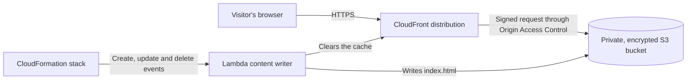

*Figure 1: Final design of the static website stack.*

A visitor connects to CloudFront over HTTPS. CloudFront fetches the page from a private S3 bucket and signs each request through Origin Access Control (OAC). The bucket policy only accepts requests from that one distribution [7]. Nobody uploads the page by hand: a Lambda function, defined in the same template, writes `index.html` into the bucket during deployment. The site was built in three versions, described below.

### 4.2 Version 1: S3 website endpoint

The first version follows the AWS tutorial for hosting a static website on S3 [8]. The template creates a bucket with website hosting turned on, and a bucket policy that allows anyone to read objects (`s3:GetObject` only). Two of the four Block Public Access settings had to be relaxed so the public policy could be attached.

I uploaded the template in the CloudFormation console (Figure 2), added the two cost tags (Figure 3), and the stack was created in about 20 seconds. I then uploaded `index.html` to the bucket by hand (Figure 4), and the page loaded at the S3 website endpoint with my L number and name as the header (Figure 5).

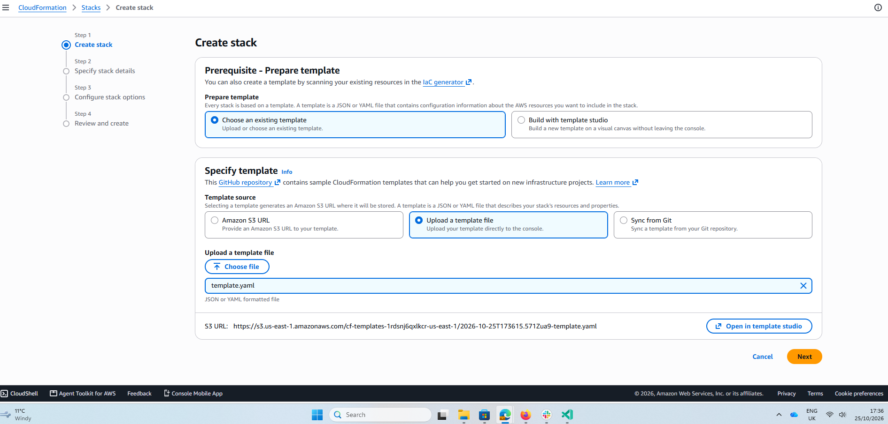

*Figure 2: Uploading the template to create the first stack.*

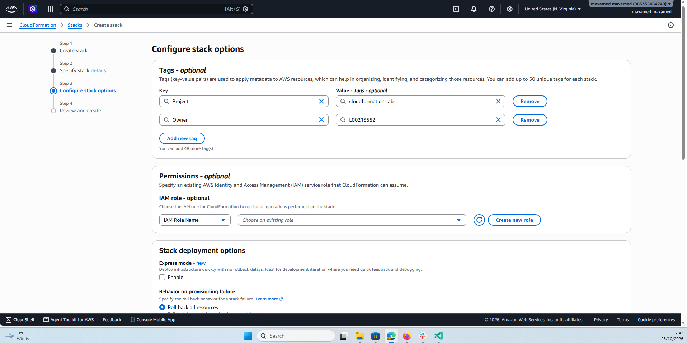

*Figure 3: Tags used to track the cost of the lab.*

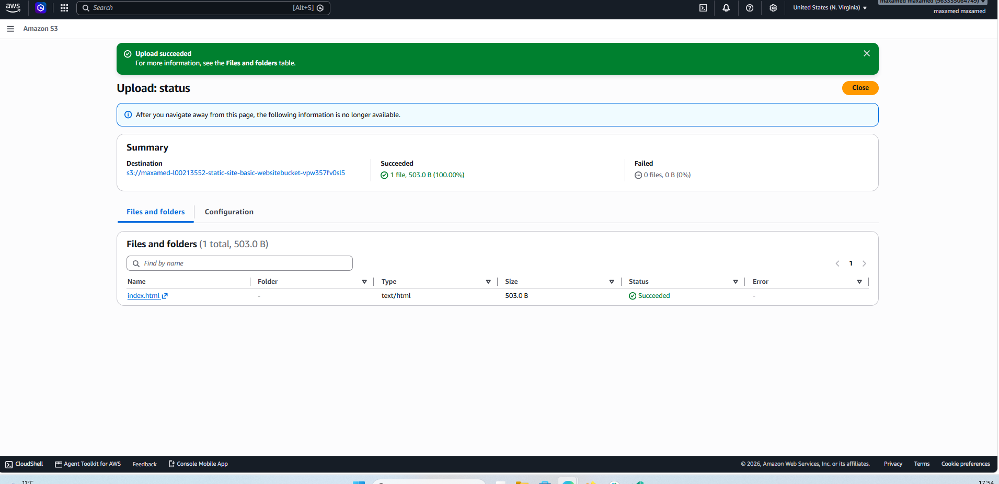

*Figure 4: Manual upload of `index.html` in version 1.*

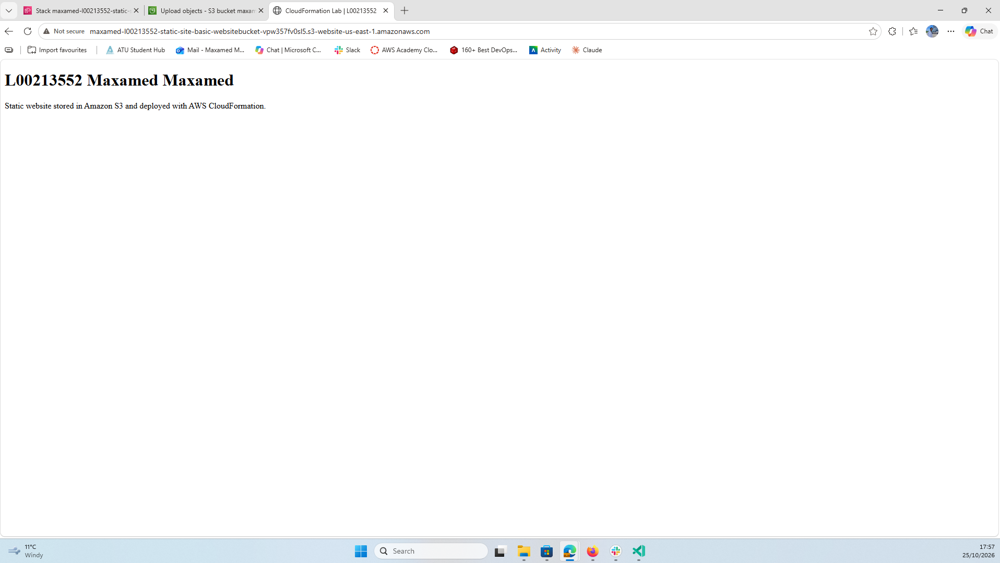

*Figure 5: Version 1 served from the S3 website endpoint. The browser marks it as not secure.*

This version met the basic requirement but had clear weaknesses. AWS states that S3 website endpoints do not support HTTPS and only serve publicly readable content [9], which explains the "Not secure" warning in Figure 5 and the need for a public bucket. The page also had to be uploaded by hand, and my name was hard coded in the HTML file.

### 4.3 Version 2: CloudFront and a private bucket

The second version kept the bucket but changed how it is reached:

- All four Block Public Access settings are on [10], and object ACLs are disabled, so the bucket policy is the only thing that grants access.
- Objects are encrypted at rest with S3 managed keys, and versioning is turned on so an earlier version of a file can be restored [11].
- A CloudFront distribution with Origin Access Control is now the public facing web service. AWS recommends OAC for restricting access to an S3 origin [7].
- The bucket policy allows `s3:GetObject` only for the CloudFront service, and only when the request comes from this distribution. A second statement denies any request that does not use TLS.
- Plain HTTP requests are redirected to HTTPS. The distribution supports HTTP/2 and HTTP/3, compresses responses, and uses the AWS managed `CachingOptimized` cache policy [12] and `SecurityHeadersPolicy` response headers policy [13]. It uses the lowest cost price class, which serves from edge locations in North America and Europe.

The logical names of the bucket and its policy were kept the same as in version 1. This told CloudFormation to update the existing bucket rather than replace it, so the uploaded page survived. The change set confirmed this before anything was applied: two resources modified and two added, with no replacements (Figure 6), and all deployment validations passed (Figure 7).

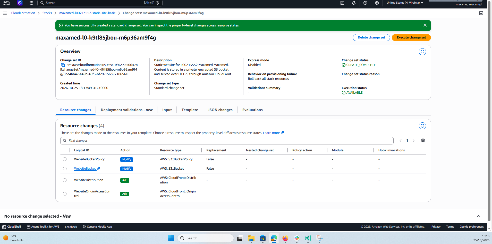

*Figure 6: Change set for version 2. Both modified resources show `Replacement: False`.*


*Figure 7: Deployment validations passed before the change set was executed.*

| Test | Expected result | Observed result | Evidence |
|---|---|---|---|
| Open the CloudFront address | Page loads over HTTPS | Page loads with a padlock and the correct header | Figure 8 |
| Open the old S3 website endpoint | No longer serves the site | `404 NoSuchWebsiteConfiguration` | Figure 9 |
| Open the object URL directly in S3 | Access refused | `AccessDenied` | Observed during testing |

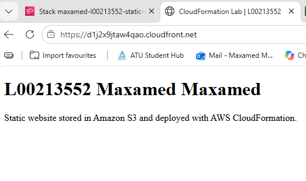

*Figure 8: The site served over HTTPS through CloudFront.*

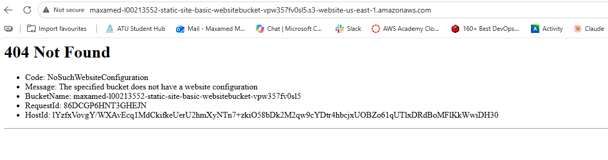

*Figure 9: The old public S3 website endpoint no longer works.*

### 4.4 Version 3: Lambda custom resource and parameters

CloudFormation has no resource type that puts a file into a bucket. A custom resource fills that gap: CloudFormation calls a function whenever the custom resource is created, updated or deleted, and waits for the function's reply [14]. This also uses CloudFormation and Lambda together, which is the relationship the brief highlights [2]. Version 3 added:

- **Two parameters**, `StudentName` and `StudentNumber`, each with an `AllowedPattern` constraint. An L number must be the letter L followed by eight digits. Constraining parameters is a CloudFormation best practice [15].
- **A log group** for the function, with logs kept for 14 days.
- **A least privilege IAM role.** The function can write to its own log group, put and delete objects in this bucket only, list object versions in this bucket, and clear the cache of this distribution only.
- **A Python 3.13 function** written inline in the template, using the `cfn-response` module that AWS provides for inline code [16]. On create and update, it writes `index.html` from the parameter values, with the values HTML escaped, and then clears the CloudFront cache. On delete, it removes every object version, so the versioned bucket can be deleted with the stack. The function replies to CloudFormation even when something fails. Without a reply, the stack would wait for the custom resource timeout, one hour by default, and then fail [14].
- **The custom resource** that runs the function. It passes the parameter values to the function, so changing a parameter triggers an update and rewrites the page.

The separate `static-site/site/index.html` file was deleted, so the template is now the only copy of the page.

Because the template creates an IAM role, CloudFormation asked me to acknowledge that before creating the change set (Figure 10). Once the function existed, the custom resource took about three seconds to complete (Figure 11).


*Figure 10: CloudFormation requires explicit acknowledgement before it creates IAM resources.*

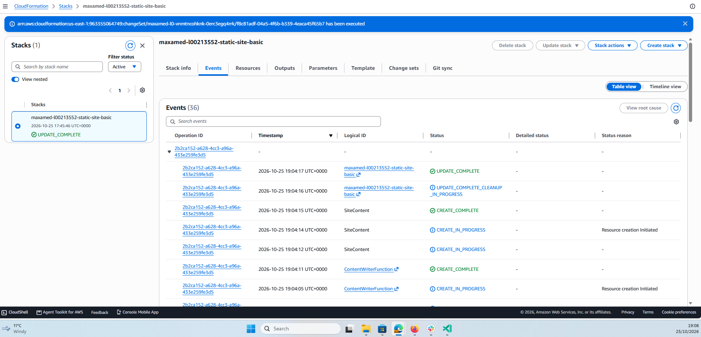

*Figure 11: The `SiteContent` custom resource completes, followed by `UPDATE_COMPLETE`.*

| Test | Expected result | Observed result | Evidence |
|---|---|---|---|
| Open the site after the update | New text written by the Lambda function | "This page was written by a Lambda function during deployment." | Figure 12 |
| Check versions of `index.html` | Old and new versions both kept | Two versions: `null` (the manual upload) and the Lambda version | Figure 13 |
| Enter `123` as the L number | Rejected before any change | `ValidationError` with my constraint message | Figure 14 |

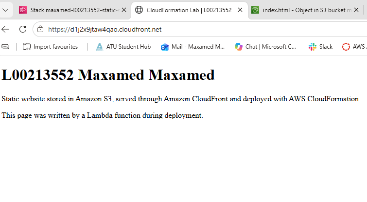

*Figure 12: The page written by the Lambda function, served over HTTPS.*

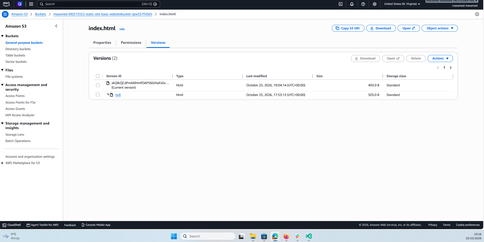

*Figure 13: Two versions of `index.html`.*

The older version in Figure 13 has the version ID `null` because it was uploaded before versioning was turned on. Every object written since then has a real version ID.

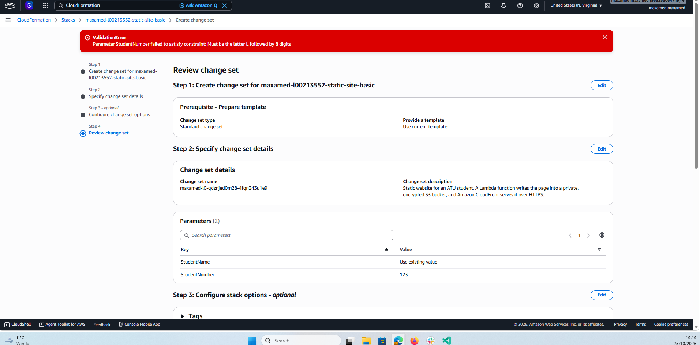

*Figure 14: An invalid L number is rejected by CloudFormation itself.*

The check in Figure 14 happens on the AWS side when the change set is submitted, not in the browser, so it applies whichever tool deploys the template.

## 5. Part A.b: Three tier architecture

### 5.1 Design

A three tier architecture separates presentation, application logic and data storage, so that each tier can be scaled and secured on its own [17]. In this design, each tier runs in its own pair of subnets across two Availability Zones, and each tier only accepts traffic from the tier directly above it.

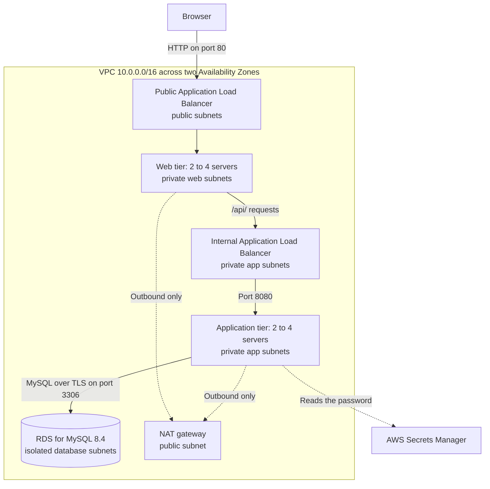

*Figure 15: Three tier architecture deployed by `three-tier/template.yaml`.*

The security groups form a chain. No group allows SSH.

| Security group | Only inbound rule |
|---|---|
| Public load balancer | TCP 80 from the internet |
| Web servers | TCP 80 from the public load balancer group |
| Internal load balancer | TCP 80 from the web server group |
| Application servers | TCP 8080 from the internal load balancer group |
| Database | TCP 3306 from the application server group |

Because each rule refers to the security group of the tier above rather than to IP addresses, the rules stay correct as servers are replaced and load balancers change their addresses.

### 5.2 Network

The VPC uses the range `10.0.0.0/16`, split into eight `/24` subnets with the `Fn::Cidr` function, so no address range is typed by hand and none can overlap. The Availability Zones come from `Fn::GetAZs` rather than being hard coded.

| Subnets | Route to the internet | Used by |
|---|---|---|
| Public A and B | Both directions, through the internet gateway | Public load balancer, NAT gateway |
| Web A and B | Outbound only, through the NAT gateway | Web servers |
| App A and B | Outbound only, through the NAT gateway | Internal load balancer, application servers |
| Database A and B | None | RDS |

The NAT gateway lets private servers download packages without being reachable from the internet [18]. A gateway endpoint for S3 is attached to the private route table. It keeps S3 traffic on the AWS network and has no extra charge [19].

The network stack was created in about two minutes. CloudFormation worked out the order of creation from the references in the template. For example, the private default route waited for the NAT gateway to finish, because the route points at it (Figure 16). I never had to write that order down. The VPC resource map shows the result: eight subnets across `us-east-1a` and `us-east-1b`, the route tables, the internet gateway, the NAT gateway and the S3 endpoint (Figure 17).

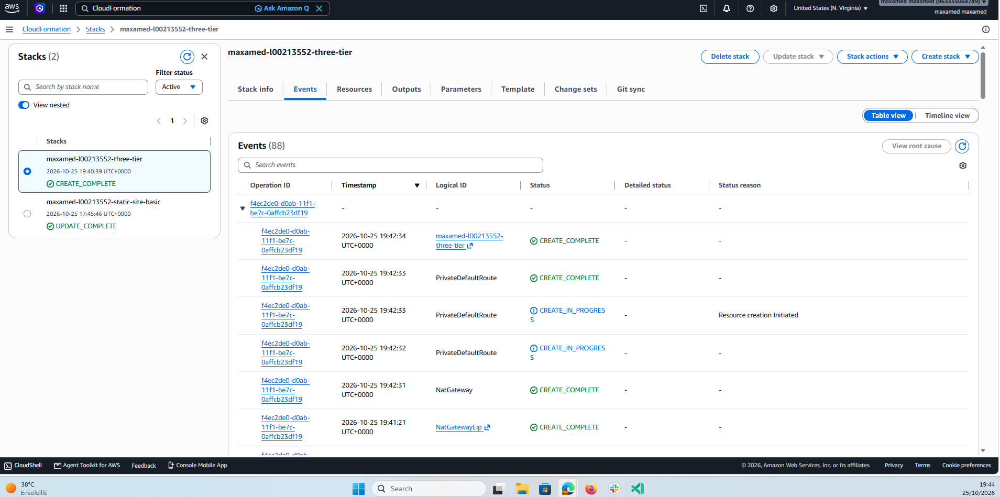

*Figure 16: The private route is only created after the NAT gateway is complete.*

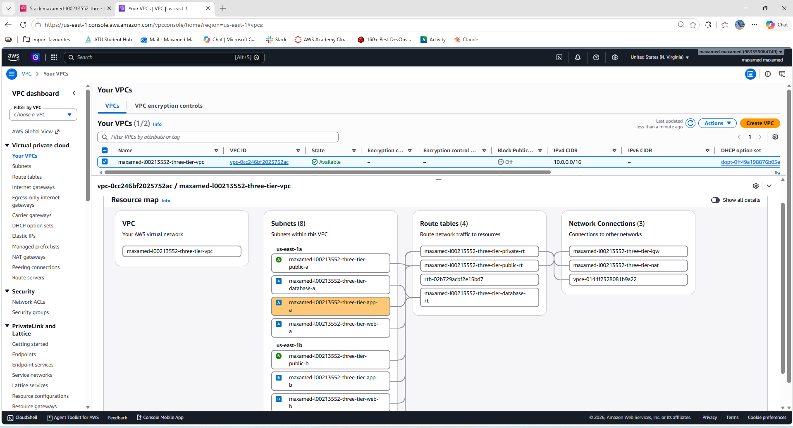

*Figure 17: VPC resource map of the three tier network.*

The resource map shows a fourth route table with no name. This is the main route table that AWS creates with every VPC. None of my subnets use it, because the template associates every subnet with a route table explicitly. If a subnet were ever added without an association, it would fall back to this empty table rather than gaining internet access by accident. The database route table has only the `local` route, so the database subnets have no path to or from the internet.

### 5.3 Web tier

The web tier has a public Application Load Balancer in the two public subnets, set to drop requests with malformed headers. Behind it, an Auto Scaling group runs between two and four web servers in the private web subnets. Each server is built from a launch template that:

- uses the latest Amazon Linux 2023 image, looked up from a public Systems Manager parameter at deploy time, instead of a hard coded image ID
- requires IMDSv2, the session based version of the instance metadata service [20]
- encrypts its gp3 root volume
- has an instance role that allows Session Manager, so an administrator can open a shell from the console without SSH keys or an open port [21]
- installs Apache at first boot and writes a page that shows the server's instance ID and Availability Zone, plus a `/health` page for the load balancer

The Auto Scaling group uses the load balancer's health checks [22] and a target tracking policy that keeps average CPU near 50 percent [23]. Two CloudFormation features make deployments trustworthy:

- A **creation policy** makes CloudFormation wait for a success signal from each server before it marks the group complete [24]. Each server sends that signal with `cfn-signal` at the end of its startup script [25]. If any startup step fails, a trap in the script sends a failure signal straight away, so the stack fails fast instead of waiting for the timeout.
- An **update policy** replaces servers one at a time, keeping at least one in service and waiting for each new server's signal [26].

| Test | Expected result | Observed result | Evidence |
|---|---|---|---|
| Refresh the web address | Requests shared across both zones | Alternated between `us-east-1a` and `us-east-1b` | Figures 18 and 19 |
| Check the web servers | No public IP address | Public IPv4 address is empty | Figure 20 |
| Terminate one web server | Replaced automatically | Terminated at 14:07:37, replacement launched at 14:07:39 | Figure 21 |

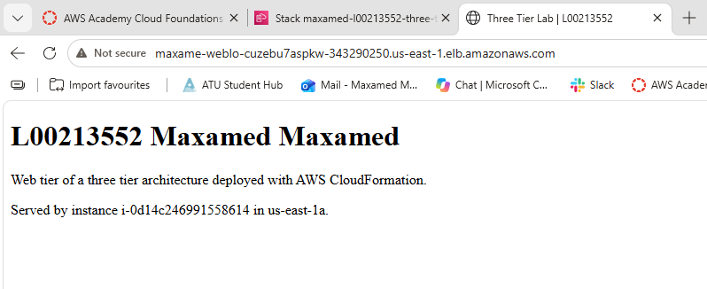

*Figure 18: Web page served from a server in `us-east-1a`.*

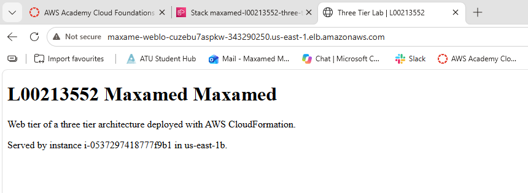

*Figure 19: The same address served from a server in `us-east-1b`.*


*Figure 20: A web server with a private address only.*

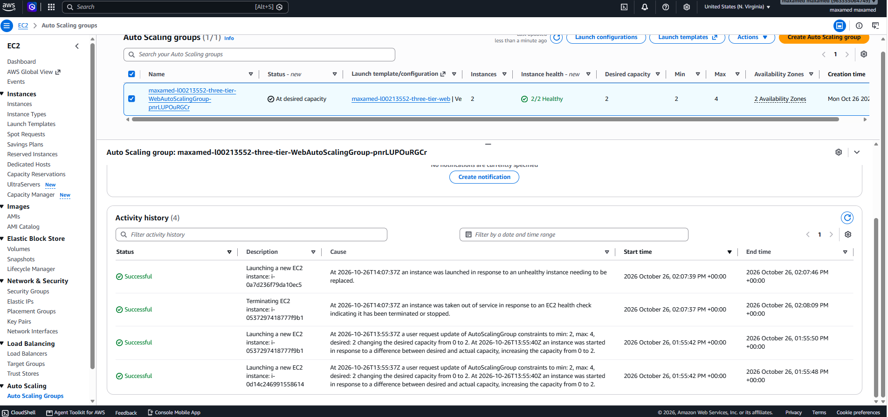

*Figure 21: Auto Scaling activity history after one web server was terminated.*

The termination test in Figure 21 shows self healing. Two seconds after the instance was taken out of service, Auto Scaling launched a replacement "in response to an unhealthy instance needing to be replaced", and the group returned to two healthy servers without any action from me.

### 5.4 Application tier

The application tier sits behind an internal Application Load Balancer in the private app subnets. An internal load balancer only has private addresses. Behind it, a second Auto Scaling group runs two to four application servers. Each runs a small Python API on port 8080, installed as a system service that runs under a temporary unprivileged user rather than root and restarts automatically if it stops. The tier has its own IAM role, separate from the web tier, so each tier can be given only the permissions it needs.

The web servers now forward any request under `/api/` to the internal load balancer, and the page asks the API which server answered. The browser only ever talks to the web tier.

Because the web servers' startup script changed, this update was a real test of the update policy. CloudFormation announced the rolling update (Figure 22), replaced one server at a time, and waited for each new server's signal (Figure 23).

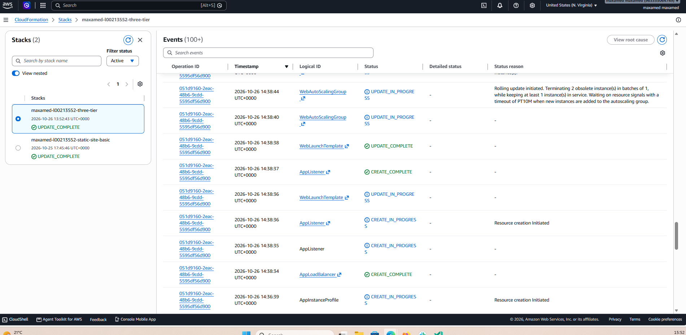

*Figure 22: "Rolling update initiated. Terminating 2 obsolete instance(s) in batches of 1, while keeping at least 1 instance(s) in service."*

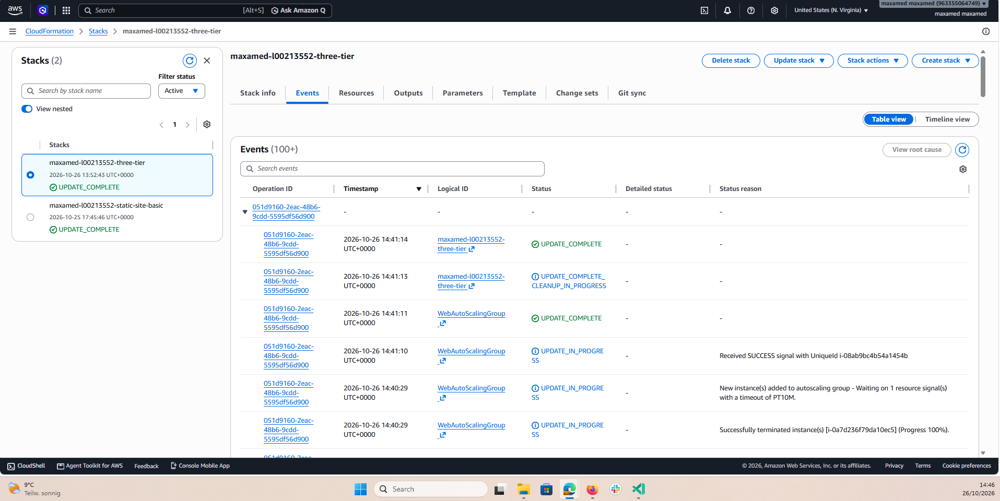

*Figure 23: A new web server sends its success signal before the update completes.*

| Test | Expected result | Observed result | Evidence |
|---|---|---|---|
| Open the web address | Page shows both a web server and an app server | Web server `i-08ab9bc4b54a1454b` and an app server, both named | Figure 24 |
| Call `/api/info` through the web address | JSON from an app server | `{"tier": "application", "instance": "i-0916fc70e3b33750a", "zone": "us-east-1b"}` | Figure 25 |
| Open the internal load balancer address from the internet | Cannot be reached | Browser cannot reach the address | Figure 26 |

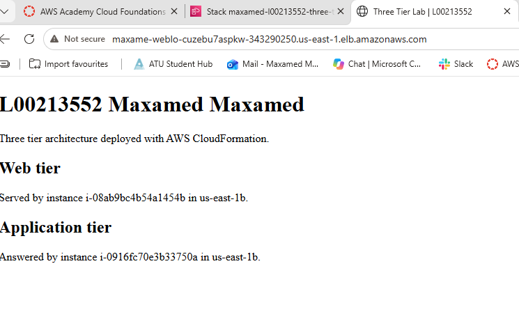

*Figure 24: Page showing the web server and the application server that handled the request.*

The web server in Figure 24, `i-08ab9bc4b54a1454b`, is the same server whose success signal appears in Figure 23. It is one of the new servers built during the rolling update.

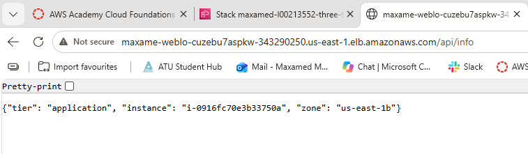

*Figure 25: The API reached through the public address.*

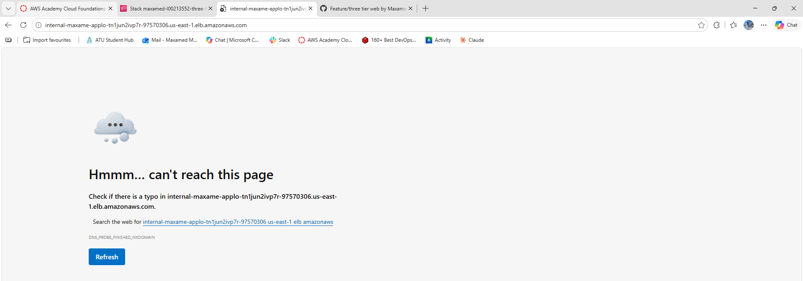

*Figure 26: The internal load balancer cannot be reached from the internet.*

The name of an internal load balancer points only to private addresses inside the VPC. My browser reported the name as not found, and even where such a name resolves, those addresses cannot be routed from the internet. The only path to the application tier is through the web servers.

### 5.5 Database tier

**Engine and version.** The database is RDS for MySQL. I chose version 8.4 because MySQL 8.0 reached the end of standard support on RDS on 31 July 2026 and is now only available under paid Extended Support, while 8.4 is in standard support until 31 July 2029 [27]. The template asks for the major version only, and RDS picked 8.4.11. Extended Support is turned off, so the database can never move into paid support without a decision. `cfn-lint` only accepts exact versions such as `8.4.11`, but AWS documents that a major version on its own is valid [27]. With automatic minor upgrades turned on, an exact version in the template would soon disagree with the running database. I therefore kept `"8.4"` and recorded an exception for that single rule, with the reason written next to it in the template.

**Placement and storage.** The instance is `db.t4g.micro` with 20 GiB of encrypted gp3 storage. It is not publicly accessible and sits in the isolated database subnets. Daily automated backups are kept for one day. A `DatabaseMultiAz` parameter turns on a standby copy in the second zone with automatic failover [28]. It is off by default because it doubles the database cost.

**Password handling.** No password appears anywhere in the template. RDS generates the master password and stores it in Secrets Manager [29]. A separate IAM policy lets only the application tier role read that one secret. The API reads the secret when it first needs it, caches it, and reads it again if a login is refused, which covers the case where the password has been rotated. It connects over TLS and checks the server certificate and host name against the Amazon RDS certificate bundle [30], so the password is only sent to the real database.

**Health checks.** The API's `/health` page deliberately does not touch the database. If it did, a database problem would make the load balancer mark every application server as unhealthy, and Auto Scaling would replace healthy servers for no reason.

**Deletion.** The database has `DeletionPolicy` and `UpdateReplacePolicy` set to `Delete`, because the lab data is disposable. A production database would use `Snapshot` so that a final backup is kept [31].

Before deployment, the change set showed four new resources and two modified launch templates, with no replacements (Figure 27).

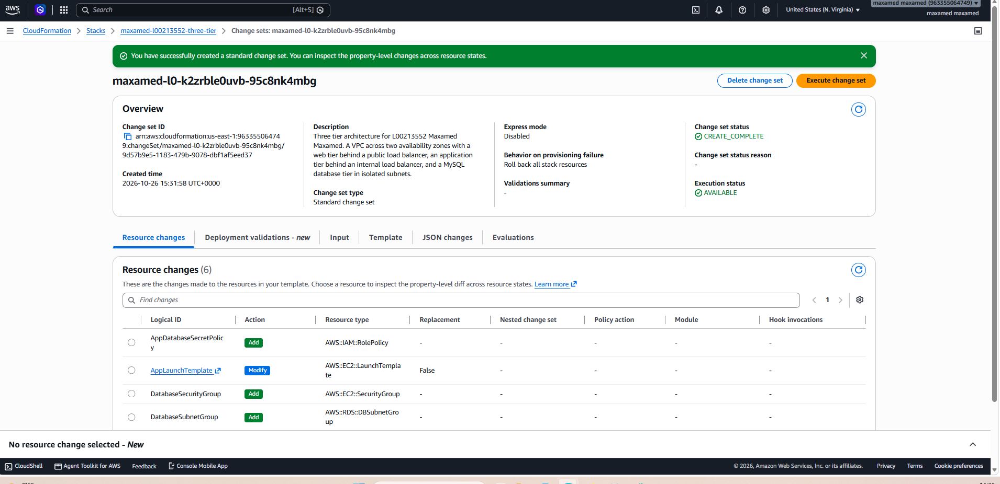

*Figure 27: Change set for the database tier.*

| Test | Expected result | Observed result | Evidence |
|---|---|---|---|
| Refresh the page several times | One shared counter, whichever servers answer | Count rose 1, 2, 3 across different web and app servers in both zones | Figures 28 and 29 |
| Check the RDS configuration | Encrypted, MySQL 8.4, Extended Support off | Encryption enabled, 8.4.11, Extended Support disabled, credentials in Secrets Manager | Figure 30 |
| Check how clients connect | Password taken from Secrets Manager, TLS verified | AWS's own connection example reads the secret and uses `--ssl-mode=VERIFY_IDENTITY` | Figure 31 |
| Check the secret | Created by RDS and read by the app | Secret created by RDS, last retrieved on the day of the test | Figure 32 |

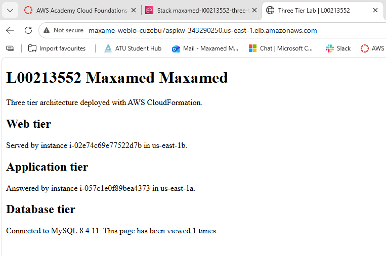

*Figure 28: First visit. Web server in `us-east-1b`, application server in `us-east-1a`, count 1.*

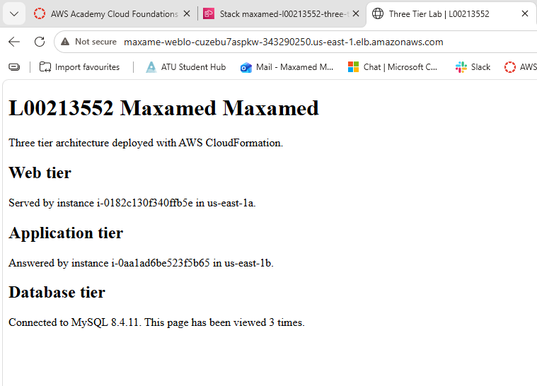

*Figure 29: Third visit. Different web and application servers, in the opposite zones, count 3.*

Figures 28 and 29 show the most important result of the three tier build. Different servers in different zones answered, yet the count carried on from where it left off. The application servers keep no data of their own, so any of them can answer any request. That is what allows the tier to scale out and replace servers freely.

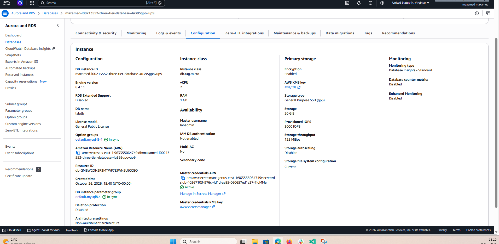

*Figure 30: RDS configuration of the database.*

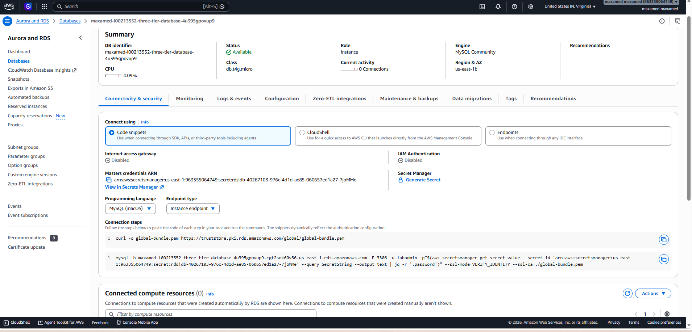

*Figure 31: The RDS console's own connection example takes the password from Secrets Manager and verifies TLS.*

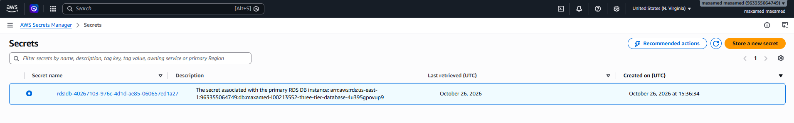

*Figure 32: The secret created by RDS, showing when it was last retrieved.*

Two failure cases were also tested off AWS, with the same Python code and library versions running against a local MySQL compatible database: changing the password in both the database and the secret, which the API recovered from without an error, and stopping the database, after which the API reported the database as unavailable while `/health` stayed healthy.

### 5.6 Both setups and tear down

Figure 33 shows the two separate setups the brief asks for, running side by side. After testing, I deleted the three tier stack. Because of the deletion policy, no snapshot was left behind to keep charging. The template can rebuild all three tiers in about 20 to 30 minutes, most of which is RDS creating the database.

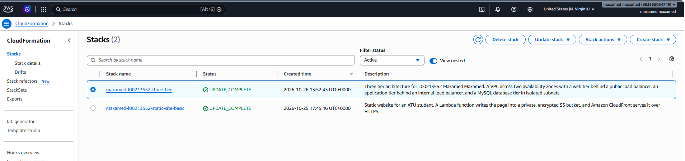

*Figure 33: The static website stack and the three tier stack.*

## 6. Continuous integration

The workflow in `.github/workflows/cfn-lint.yml` runs `cfn-lint` [32] on both templates for every pull request into `main`, every push to `main`, and on demand from the Actions tab [33]. Its design choices:

- **Least privilege.** The job's token can only read the repository (`permissions: contents: read`) [34], and the job holds no AWS credentials at all.
- **Repeatable results.** `cfn-lint` is pinned to version 1.58.0, the same version used locally, so a new linter release cannot fail the pipeline without a code change. The workflow uses recent major versions of the official actions (`actions/checkout@v6` and `actions/setup-python@v6`), which run on Node 24.
- **Clear failures.** Each template is linted in its own step, so the log shows exactly which template failed.

I tested the workflow by breaking a template on purpose:

| Commit | Change | Check result |
|---|---|---|
| `0734db3` | Add the workflow | Passed in 20 seconds |
| `eac4296` | Change `AWS::S3::Bucket` to `AWS::S3::Buckett` | Failed in 18 seconds with `E3006 Resource type 'AWS::S3::Buckett' does not exist` (Figure 34) |
| `c9a7625` | `git revert` of the previous commit | Passed in 25 seconds (Figure 35) |

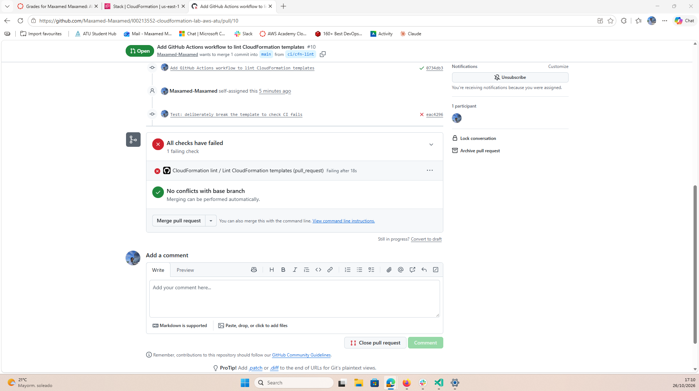

*Figure 34: The check fails on the commit with the deliberate error.*

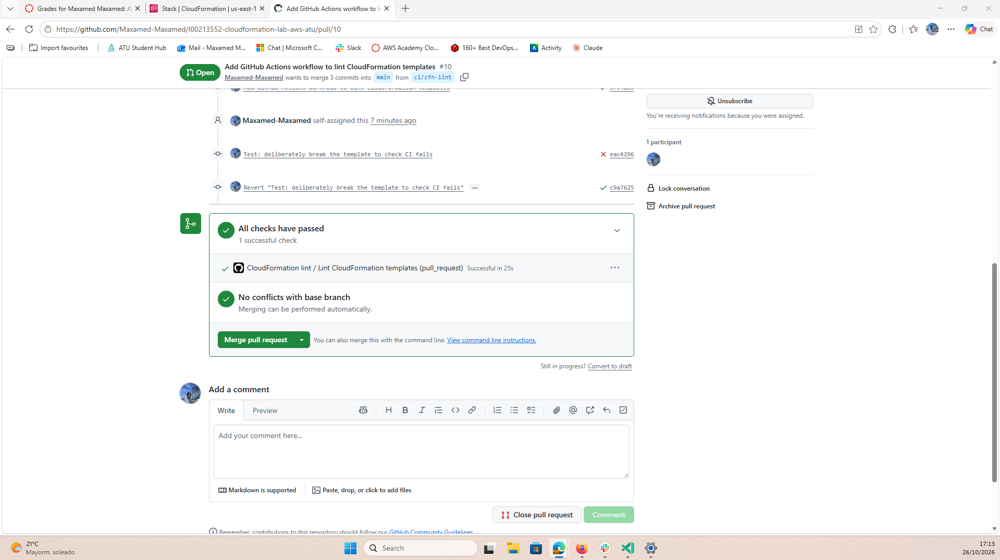

*Figure 35: The check passes again after the revert. The commit list shows the failing commit and the fix.*

I used `git revert` rather than rewriting history, so the test stays visible in the commit list. Humble and Farley argue that every change should trigger fast, automated feedback, so problems are found when they are cheap to fix [35]. Here, a broken template is caught on GitHub in under half a minute, before anyone deploys it. This also supports team work. Every reviewer sees the same check result on every pull request, and the standard is enforced by the pipeline rather than by memory. Validating templates before use is also one of AWS's CloudFormation best practices [15].

## 7. Part B: Best practices, power tools and ilities

The AWS Well-Architected Framework groups the qualities of a cloud workload into pillars, including security, reliability, performance efficiency and cost optimisation [36]. I use those headings below, after the general best practices and the tools.

### 7.1 Best practices

The CloudFormation best practices guide [15] recommends several habits that this project follows:

| Best practice [15] | How it was applied |
|---|---|
| Use code reviews and revision control | Every template change was made on a branch and merged through a pull request |
| Create change sets before updating stacks | Every update was previewed as a change set (Figures 6 and 27) |
| Use parameter constraints | `AllowedPattern` and `AllowedValues` on every free text and size parameter (Figure 14) |
| Use AWS specific parameter types | The server image is a Systems Manager parameter type, resolved to the latest Amazon Linux 2023 image at deploy time |
| Do not embed credentials in templates | The database password is generated by RDS and kept in Secrets Manager |
| Manage all stack resources through CloudFormation | No resource was created or edited by hand, so the templates match what runs in AWS |
| Validate templates before using them | `cfn-lint` locally and in GitHub Actions on every pull request |

Other practices in the code:

- **Comments.** Both templates explain every resource, and the reason behind each security and cost decision. I added my own explanatory comments, including the overview at the top of the three tier template.
- **Naming and tags.** Resource names are built from the stack name, so two copies of a stack never clash, and both stacks carry the cost tags.
- **Outputs.** Each stack prints the addresses needed for testing, so nothing has to be looked up by hand.
- **No hard coded values that can drift.** Subnet ranges come from `Fn::Cidr`, Availability Zones from `Fn::GetAZs`, and the server image from Systems Manager.
- **Pinned versions.** MySQL 8.4, PyMySQL 1.1.1, boto3 1.35.99 and cfn-lint 1.58.0 are pinned, so a rebuild behaves the same as the tested version.
- **Documented exceptions.** The one linter rule that is switched off has its reason written next to it.

### 7.2 Power tools

- **VS Code Insiders** was the editor for templates, Markdown and Git.
- **Claude**, an LLM assistant, was used for planning, explanations, initial template code, checking files before deployment and drafting documentation. Section 11 sets out exactly how.
- **cfn-lint** ran locally before each deployment and in GitHub Actions on every pull request. The workflow file itself was checked with `actionlint`.
- **CloudFormation console features** gave fast feedback: change sets and deployment validations before each update, the Events tab during it, and the VPC resource map afterwards.
- **GitHub Actions** turned the lint check into a gate that runs without anyone remembering to run it.

These tools needed checking too. Two examples from this project:

- The assistant predicted that the web Auto Scaling group would appear as modified in the application tier change set. It did not, because the new launch template version number only exists once the launch template has been updated, so CloudFormation resolves it during execution. The update still happened, as Figures 22 and 23 show, but the preview alone did not prove it.
- `cfn-lint` flagged `EngineVersion: "8.4"` as an error, while the AWS documentation says a major version is valid. Following the tool blindly would have made the template worse.

In both cases the evidence, not the tool, decided what was correct.

### 7.3 Security

| Control | Where | Why |
|---|---|---|
| Private, encrypted S3 bucket with all Block Public Access settings on | Static site | The content cannot be read except through CloudFront [10] |
| Origin Access Control and a bucket policy limited to one distribution | Static site | Only my distribution can read the bucket [7] |
| HTTPS redirect, TLS only bucket policy, security response headers | Static site | Traffic is encrypted and common browser attacks are harder [13] |
| Least privilege IAM roles, scoped to single resources | Lambda, web and app roles | A compromised component can do very little |
| Private subnets for every server, and isolated subnets for the database | Three tier | Only the public load balancer faces the internet |
| Security group chain | Three tier | Each tier only accepts traffic from the tier above it |
| No SSH, Session Manager instead | Web and app servers | No keys to leak and no open management port [21] |
| IMDSv2 required | Web and app servers | Requires a session token for every metadata request [20] |
| Encrypted EBS volumes and RDS storage | Three tier | Data at rest is encrypted |
| Password generated by RDS and kept in Secrets Manager, readable by the app role only | Database | No secret in code, templates or logs [29] |
| TLS with certificate and host name verification to the database | App to database | The password is only sent to the real database [30] |
| Read only token and no AWS credentials in CI | GitHub Actions | The pipeline cannot change the repository or the AWS account [34] |
| Explicit acknowledgement of IAM resources | CloudFormation | IAM changes cannot slip through unnoticed (Figure 10) |

### 7.4 Scalability and reliability

- **Horizontal scaling.** Both server tiers are Auto Scaling groups of two to four servers with CPU target tracking [23]. The application servers are stateless, as Figures 28 and 29 show, so adding servers adds capacity without any shared session problems.
- **Two Availability Zones.** Every tier spans `us-east-1a` and `us-east-1b`, so the loss of one zone leaves a working copy of each server tier.
- **Self healing.** Load balancer health checks feed the Auto Scaling groups [22], and a replacement was launched two seconds after a web server was terminated (Figure 21).
- **Safe deployments.** Creation policies and signals mean a stack only reports success once servers really work [24], [25]. Rolling updates keep at least one server in service [26]. If anything fails, CloudFormation rolls the stack back to its last working state.
- **Database.** The database can scale up by changing the instance class parameter, and the Multi-AZ parameter adds a standby with automatic failover [28].
- **Static site.** CloudFront scales on its own, and versioning protects against a bad upload [11].

### 7.5 Performance

- CloudFront serves the static site from edge locations close to visitors, with compression and HTTP/2 and HTTP/3 [12].
- Load balancers spread requests across healthy servers in both zones, and target tracking adds servers before CPU becomes a bottleneck [23].
- Clearing the CloudFront cache after each page update means visitors get the new page straight away, while ordinary requests still come from the cache.
- RDS uses gp3 storage, which shows a baseline of 3,000 IOPS in Figure 30.
- The S3 gateway endpoint keeps package downloads from S3 on the AWS network [19].

### 7.6 Cost

- One NAT gateway instead of one per zone, a trade off discussed in Section 9.
- Small instance sizes by default (`t3.micro` and `db.t4g.micro`), changeable through parameters.
- The lowest cost CloudFront price class, and log retention limited to 14 days.
- The free S3 gateway endpoint [19], and RDS Extended Support turned off.
- Cost tags on both stacks, and the three tier stack deleted at the end of each session.

## 8. Choice of tool and critique

The AWS page highlighted in the brief lists three ways to define infrastructure for Lambda based applications: CloudFormation, AWS SAM and the AWS CDK [2]. Terraform is a common alternative outside AWS's own tools [37].

| Tool | Strengths | Weaknesses for this lab |
|---|---|---|
| CloudFormation | Native to AWS, no state file to manage, change sets, automatic rollback | Verbose YAML, little support for loops or reuse |
| AWS SAM | Shorter syntax for serverless resources, built on CloudFormation [2] | Adds little for EC2, load balancers and RDS |
| AWS CDK | Real programming languages with loops and reuse, generates CloudFormation [2] | Adds a build step and a language runtime, and the template becomes generated output |
| Terraform | Works across many providers, not only AWS [37] | Needs its own state to be stored and protected, and it is not the tool the lab is about |

CloudFormation was the right choice for this lab, because the brief is about CloudFormation and because change sets and rollback suited a careful, step by step build. Its weaknesses showed clearly, though. The three tier template is over 1,000 lines with comments, and the eight subnet definitions are almost identical. `Fn::ForEach` could generate them in a loop, but it needs the `AWS::LanguageExtensions` transform [38]. The CDK would solve the repetition in a more general way.

I also considered a serverless application tier, with API Gateway and Lambda in place of EC2 servers [17]. It would remove the NAT gateway and all server patching. I kept EC2 because it shows the classic tiers, load balancing and Auto Scaling more directly, which are the concepts the lab focuses on.

## 9. Limitations and future work

1. **HTTP on the public load balancer.** HTTPS needs a domain name and a certificate from AWS Certificate Manager. Placing CloudFront in front of the load balancer would be another option.
2. **One NAT gateway.** If its zone failed, servers in the other zone would lose outbound access. Zonal NAT gateways need one gateway and one route per zone. AWS now also offers regional NAT gateways, which spread across zones automatically and do not need a public subnet [39]. That would be my next change.
3. **Single zone database by default.** Setting `DatabaseMultiAz` to `true` adds a standby with automatic failover [28].
4. **Manual deployment.** Stacks were deployed from the console. The next step would be a GitHub Actions job that creates a change set for review and executes it after approval, using short lived credentials rather than stored keys.
5. **Template size.** The three tier template could be split into one stack per tier, or the subnets generated with `Fn::ForEach` [38].
6. **HTML inside the templates.** This is fine for one page, but a larger site would be better uploaded from files in the repository by the pipeline.
7. **Observability.** Load balancer access logs, VPC flow logs and alarms are not yet enabled, and there is no web application firewall.
8. **Naming.** The website stack is still named `...-static-site-basic`, because CloudFormation stacks cannot be renamed. The visit counter also says "1 times" for the first visit.

**Reflection.** Building in small, tested steps worked well. Each pull request had one clear purpose, and the "known limitations" in one became the goal of the next. Change sets gave me confidence that an update would not delete something important, and the Events tab became the first place I looked whenever something seemed slow or unclear. Two things I would do differently: get command line deployment working early, so it could move into the pipeline, and take each screenshot under a final file name at the moment it is captured.

## 10. How to deploy and delete

**Console, as used in this lab**

1. In the CloudFormation console in `us-east-1`, choose **Create stack**, then upload `static-site/template.yaml` or `three-tier/template.yaml`.
2. Keep the default parameter values, or enter your own name and L number.
3. Add the tags `Project` and `Owner`, then acknowledge that the template creates IAM resources.
4. Wait for `CREATE_COMPLETE`. The website takes a few minutes because of CloudFront. The three tier stack takes about 20 to 30 minutes, mostly for RDS.
5. Open the `WebsiteURL` or `WebURL` output.
6. To update a running stack, use **Update stack**, then **Create a change set**, and review it before executing.
7. To remove everything, select the stack and choose **Delete stack**. The website's Lambda function empties its bucket first, and the database is deleted without a snapshot.

**Equivalent AWS CLI commands** (not used during the lab)

```
cfn-lint --regions us-east-1 -- static-site/template.yaml three-tier/template.yaml
aws cloudformation deploy --template-file three-tier/template.yaml --stack-name maxamed-l00213552-three-tier --capabilities CAPABILITY_IAM --region us-east-1 --no-execute-changeset
aws cloudformation deploy --template-file three-tier/template.yaml --stack-name maxamed-l00213552-three-tier --capabilities CAPABILITY_IAM --region us-east-1
aws cloudformation delete-stack --stack-name maxamed-l00213552-three-tier --region us-east-1
```

The first `deploy` command only creates a change set for review. The second applies the change.

## 11. Use of LLMs and tutorials

Part A.2 of the brief allows a tutorial or an LLM for the basics, provided both are declared and the work is taken further. The full, dated list of prompts and tutorials is in [`docs/llm-prompts.md`](docs/llm-prompts.md).

**How the LLM was used.** I used Claude (Anthropic) as an assistant throughout. It helped me plan the work and the branch structure, explained AWS and Git concepts as I went, produced the initial code for the templates, the Python API and the workflow, checked my pushed files with `cfn-lint` and local tests before I deployed them, suggested pull request descriptions, and drafted this README from my results.

**What I did.** I created and configured the repository, made every commit and opened and merged every pull request. I deployed every stack through the console, reviewed each change set, ran every test, and captured the screenshots used as figures. I made the decisions about the Region, console deployment, naming and when to delete stacks. I added my own explanatory comments to the templates, and I reviewed this write up.

**Tutorials followed.** The S3 static website tutorial [8], restricting access to an S3 origin with CloudFront [7], change sets [6], custom resources and the `cfn-response` module [14], [16], the Amazon VPC guide [40], Auto Scaling with a load balancer [22], `cfn-signal` [25], RDS password management with Secrets Manager [29], RDS for MySQL versions [27], and the AWS CLI installation guide [4].

**Taking the work further.** The tutorials gave a public S3 website and individual building blocks. The finished work goes beyond them with HTTPS through CloudFront and a private bucket, a Lambda custom resource that writes the page and cleans up on delete, validated parameters, a full three tier architecture with self healing and rolling updates, a database whose password never appears in code, TLS between the application and the database, and a CI pipeline that rejects broken templates.

## 12. References

All online sources were accessed between 10 and 26 October 2026.

[1] Amazon Web Services, "What is CloudFormation?," *AWS CloudFormation User Guide*. Available: https://docs.aws.amazon.com/AWSCloudFormation/latest/UserGuide/Welcome.html

[2] Amazon Web Services, "Using Lambda with infrastructure as code (IaC)," *AWS Lambda Developer Guide*. Available: https://docs.aws.amazon.com/lambda/latest/dg/foundation-iac.html

[3] K. Morris, *Infrastructure as Code: Dynamic Systems for the Cloud Age*, 2nd ed. Sebastopol, CA, USA: O'Reilly Media, 2020. Available: https://www.oreilly.com/library/view/infrastructure-as-code/9781098114664/

[4] Amazon Web Services, "Installing or updating to the latest version of the AWS CLI," *AWS Command Line Interface User Guide for Version 2*. Available: https://docs.aws.amazon.com/cli/latest/userguide/getting-started-install.html

[5] Amazon Web Services, "Login for AWS local development using console credentials," *AWS Command Line Interface User Guide for Version 2*. Available: https://docs.aws.amazon.com/cli/latest/userguide/cli-configure-sign-in.html

[6] Amazon Web Services, "Update CloudFormation stacks using change sets," *AWS CloudFormation User Guide*. Available: https://docs.aws.amazon.com/AWSCloudFormation/latest/UserGuide/using-cfn-updating-stacks-changesets.html

[7] Amazon Web Services, "Restrict access to an Amazon S3 origin," *Amazon CloudFront Developer Guide*. Available: https://docs.aws.amazon.com/AmazonCloudFront/latest/DeveloperGuide/private-content-restricting-access-to-s3.html

[8] Amazon Web Services, "Tutorial: Configuring a static website on Amazon S3," *Amazon S3 User Guide*. Available: https://docs.aws.amazon.com/AmazonS3/latest/userguide/HostingWebsiteOnS3Setup.html

[9] Amazon Web Services, "Website endpoints," *Amazon S3 User Guide*. Available: https://docs.aws.amazon.com/AmazonS3/latest/userguide/WebsiteEndpoints.html

[10] Amazon Web Services, "Blocking public access to your Amazon S3 storage," *Amazon S3 User Guide*. Available: https://docs.aws.amazon.com/AmazonS3/latest/userguide/access-control-block-public-access.html

[11] Amazon Web Services, "Retaining multiple versions of objects with S3 Versioning," *Amazon S3 User Guide*. Available: https://docs.aws.amazon.com/AmazonS3/latest/userguide/Versioning.html

[12] Amazon Web Services, "Use managed cache policies," *Amazon CloudFront Developer Guide*. Available: https://docs.aws.amazon.com/AmazonCloudFront/latest/DeveloperGuide/using-managed-cache-policies.html

[13] Amazon Web Services, "Use managed response headers policies," *Amazon CloudFront Developer Guide*. Available: https://docs.aws.amazon.com/AmazonCloudFront/latest/DeveloperGuide/using-managed-response-headers-policies.html

[14] Amazon Web Services, "Create custom provisioning logic with custom resources," *AWS CloudFormation User Guide*. Available: https://docs.aws.amazon.com/AWSCloudFormation/latest/UserGuide/template-custom-resources.html

[15] Amazon Web Services, "CloudFormation best practices," *AWS CloudFormation User Guide*. Available: https://docs.aws.amazon.com/AWSCloudFormation/latest/UserGuide/best-practices.html

[16] Amazon Web Services, "cfn-response module," *AWS CloudFormation User Guide*. Available: https://docs.aws.amazon.com/AWSCloudFormation/latest/UserGuide/cfn-lambda-function-code-cfnresponsemodule.html

[17] Amazon Web Services, "Introduction," *AWS Serverless Multi-Tier Architectures with Amazon API Gateway and AWS Lambda* (AWS Whitepaper). Available: https://docs.aws.amazon.com/whitepapers/latest/serverless-multi-tier-architectures-api-gateway-lambda/introduction.html

[18] Amazon Web Services, "NAT gateway use cases," *Amazon VPC User Guide*. Available: https://docs.aws.amazon.com/vpc/latest/userguide/nat-gateway-scenarios.html

[19] Amazon Web Services, "Gateway endpoints for Amazon S3," *AWS PrivateLink Guide*. Available: https://docs.aws.amazon.com/vpc/latest/privatelink/vpc-endpoints-s3.html

[20] Amazon Web Services, "Use the Instance Metadata Service to access instance metadata," *Amazon EC2 User Guide*. Available: https://docs.aws.amazon.com/AWSEC2/latest/UserGuide/configuring-instance-metadata-service.html

[21] Amazon Web Services, "Working with Session Manager," *AWS Systems Manager User Guide*. Available: https://docs.aws.amazon.com/systems-manager/latest/userguide/session-manager-working-with.html

[22] Amazon Web Services, "Use ELB to distribute incoming application traffic in your Auto Scaling group," *Amazon EC2 Auto Scaling User Guide*. Available: https://docs.aws.amazon.com/autoscaling/ec2/userguide/autoscaling-load-balancer.html

[23] Amazon Web Services, "Target tracking scaling policies for Amazon EC2 Auto Scaling," *Amazon EC2 Auto Scaling User Guide*. Available: https://docs.aws.amazon.com/autoscaling/ec2/userguide/as-scaling-target-tracking.html

[24] Amazon Web Services, "CreationPolicy attribute," *AWS CloudFormation Template Reference*. Available: https://docs.aws.amazon.com/AWSCloudFormation/latest/TemplateReference/aws-attribute-creationpolicy.html

[25] Amazon Web Services, "cfn-signal," *AWS CloudFormation Template Reference*. Available: https://docs.aws.amazon.com/AWSCloudFormation/latest/TemplateReference/cfn-signal.html

[26] Amazon Web Services, "UpdatePolicy attribute," *AWS CloudFormation User Guide*. Available: https://docs.aws.amazon.com/AWSCloudFormation/latest/UserGuide/aws-attribute-updatepolicy.html

[27] Amazon Web Services, "MySQL on Amazon RDS versions," *Amazon RDS User Guide*. Available: https://docs.aws.amazon.com/AmazonRDS/latest/UserGuide/MySQL.Concepts.VersionMgmt.html

[28] Amazon Web Services, "Multi-AZ DB instance deployments for Amazon RDS," *Amazon RDS User Guide*. Available: https://docs.aws.amazon.com/AmazonRDS/latest/UserGuide/Concepts.MultiAZSingleStandby.html

[29] Amazon Web Services, "Password management with Amazon RDS and AWS Secrets Manager," *Amazon RDS User Guide*. Available: https://docs.aws.amazon.com/AmazonRDS/latest/UserGuide/rds-secrets-manager.html

[30] Amazon Web Services, "Encrypting client connections with SSL/TLS to MySQL DB instances on Amazon RDS," *Amazon RDS User Guide*. Available: https://docs.aws.amazon.com/AmazonRDS/latest/UserGuide/mysql-ssl-connections.html

[31] Amazon Web Services, "DeletionPolicy attribute," *AWS CloudFormation Template Reference*. Available: https://docs.aws.amazon.com/AWSCloudFormation/latest/TemplateReference/aws-attribute-deletionpolicy.html

[32] AWS CloudFormation, "cfn-lint: CloudFormation Linter," GitHub repository. Available: https://github.com/aws-cloudformation/cfn-lint

[33] GitHub, "GitHub Actions documentation," *GitHub Docs*. Available: https://docs.github.com/en/actions

[34] GitHub, "GitHub Actions: Control permissions for GITHUB_TOKEN," *GitHub Changelog*, 20 Apr. 2021. Available: https://github.blog/changelog/2021-04-20-github-actions-control-permissions-for-github_token/

[35] J. Humble and D. Farley, *Continuous Delivery: Reliable Software Releases through Build, Test, and Deployment Automation*. Upper Saddle River, NJ, USA: Addison-Wesley, 2010. Available: https://www.pearson.com/en-us/subject-catalog/p/continuous-delivery-reliable-software-releases-through-build-test-and-deployment-automation/P200000009113

[36] Amazon Web Services, "Definitions," *AWS Well-Architected Framework*. Available: https://docs.aws.amazon.com/wellarchitected/latest/framework/definitions.html

[37] IBM, "What is Terraform?," *IBM Think*. Available: https://www.ibm.com/think/topics/terraform

[38] Amazon Web Services, "Fn::ForEach," *AWS CloudFormation Template Reference*. Available: https://docs.aws.amazon.com/AWSCloudFormation/latest/TemplateReference/intrinsic-function-reference-foreach.html

[39] Amazon Web Services, "Regional NAT gateways for automatic multi-AZ expansion," *Amazon VPC User Guide*. Available: https://docs.aws.amazon.com/vpc/latest/userguide/nat-gateways-regional.html

[40] Amazon Web Services, "What is Amazon VPC?," *Amazon VPC User Guide*. Available: https://docs.aws.amazon.com/vpc/latest/userguide/what-is-amazon-vpc.html